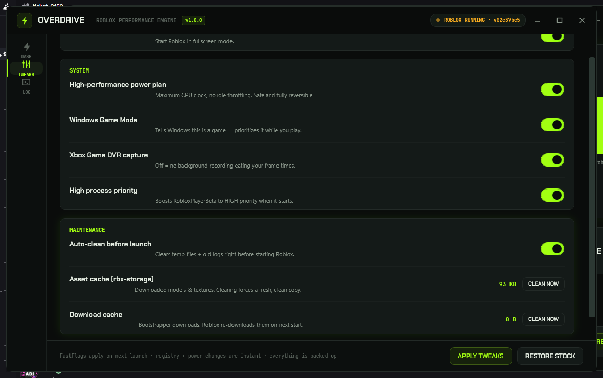

# OVERDRIVE ⚡

**Roblox Performance Engine for Windows** — one double-click applies a vetted loadout of
FastFlags, launch settings and Windows tweaks, then boots the game.



> Not affiliated with or endorsed by Roblox Corporation. Every flag used here comes from
> Roblox's own documented FastFlag list, every change is backed up, and **RESTORE STOCK**
> puts your machine back exactly the way it was.

---

## Why?

Roblox ships a pile of graphics options that are documented but defaulted off — texture
overrides, CSG level-of-detail distances, MSAA control, renderer selection — plus a handful
of Windows settings that quietly eat frame times (Game DVR background capture, power plan
throttling, low process priority).

OVERDRIVE finds your install, applies the good ones in one click, and remembers what it did.

## Features

- **PLAY ROBLOX** — applies your loadout, cleans temp junk, launches the client with
  HIGH process priority. One button, soup to nuts.
- **3 profiles + custom** — PERFORMANCE / BALANCED / SMOOTH with a live spec readout of
  exactly what the game will do. Tweak anything on the TWEAKS page and the profile flips
  to CUSTOM automatically.
- **Allowlisted FastFlags only** — 16 managed flags drawn from Roblox's official
  [FastFlag documentation](https://devforum.roblox.com/t/3966569); nothing experimental,
  nothing private, no ban-bait.
- **Launch settings** — frame-rate cap (60/144/240/360) and fullscreen written straight
  into Roblox's own `GlobalBasicSettings_13.xml`.
- **Windows tuning, no admin required** — high-performance power plan, Game Mode on,
  Xbox Game DVR off, high process priority. HKCU + powercfg only.
- **Cache maintenance** — safe auto-clean before every launch (temp files + old logs),
  plus measured manual buckets for `rbx-storage` assets and download caches.
- **Fully reversible** — a manifest records the previous value of every flag, registry key
  and power setting it touches. RESTORE STOCK undoes all of it, per-key.
- **Live activity log** — timestamped, colour-coded, copyable. Every action is auditable.
- **Ship CLI** — `--selftest` runs a 7-point environment check, plus `--help` / `--version`.

## Profiles

| Tweak                         | PERFORMANCE            | BALANCED               | SMOOTH                 |
| ----------------------------- | ---------------------- | ---------------------- | ---------------------- |
| FRM quality level override    | 1                      | 5                      | 8                      |
| Texture quality override      | LOW                    | off (in-game default)  | HIGH                   |
| MSAA samples                  | 0                      | 0                      | 4                      |
| CSG LOD switch distance       | 120 / 130 / 140 / 150  | 500 / 550 / 600 / 650  | 900 / 990 / 1080 / 1170|
| Grass distance (max / min)    | 250 / 100              | 800 / 400              | 1500 / 750             |
| Grass motion                  | reduced                | stock                  | stock                  |
| Renderer + Alt+Enter fix      | D3D11 + on             | D3D11 + on             | D3D11 + on             |

All profiles are written as a **uniform 16-key set**, so your on-disk state always maps to
exactly one profile — the app re-detects it at startup rather than trusting stale config.

## Safety model

1. **Allowlist.** Only flags present in `FlagService.Allowlist` can ever be written.
   A self-test verifies the managed subset is inside the allowlist on every build.
2. **Backups.** First touch of any file (`ClientAppSettings.json`,
   `GlobalBasicSettings_13.xml`) snapshots it to
   `%LOCALAPPDATA%\Overdrive\Backups\` before we write a byte.
3. **Manifests.** `manifest-flags.json` / `manifest-settings.json` /
   `manifest-tweaks.json` store the *previous* value of every single key we change.
4. **No admin.** Everything lives in HKCU or user folders. UAC is never triggered.
5. **RESTORE STOCK.** One button: flags restored, launch settings restored, system
   tweaks restored, profile reset to BALANCED.

## Usage

1. Double-click `Overdrive.exe`.
2. Pick a profile — or hand-tune on the **TWEAKS** page.
3. Hit **PLAY ROBLOX**.

The status pill in the header always tells you what it sees: detected version, READY /
RUNNING, or NOT FOUND (with a BROWSE button to locate `RobloxPlayerBeta.exe` manually).

## Build from source

Requires the [.NET 10 SDK](https://dotnet.microsoft.com/download/dotnet/10.0)
(`winget install Microsoft.DotNet.SDK.10`).

```powershell
.\build.ps1
# → publish\Overdrive.exe   (single self-contained file, ~125 MB, no install needed)
```

Or plain CLI:

```powershell
dotnet publish .\Overdrive.csproj -c Release -r win-x64 --self-contained true `
  -p:PublishSingleFile=true -p:IncludeNativeLibrariesForSelfExtract=true -o publish
```

Every push runs the same pipeline on GitHub Actions
([`.github/workflows/build.yml`](.github/workflows/build.yml)): build → `--selftest` →
upload artifact. Pushing a `v*` tag additionally attaches the exe to a GitHub Release.

### CLI

```
Overdrive.exe --selftest    # 7-check environment sanity test (exit 0 = all good)
Overdrive.exe --help
Overdrive.exe --version
```

## Repo layout

```
Overdrive/
├── App.xaml(.cs)        startup + CLI hooks
├── MainWindow.xaml(.cs) UI shell, pipelines, window chrome
├── Core/                FlagService · SettingsFile · SystemTweaks · CacheCleaner
│                        Launcher · RobloxLocator · Config · Vm · Cli · Log
├── Themes/              Palette (acid-green design tokens) + Controls (style library)
├── Assets/              icon + Chakra Petch / JetBrains Mono (OFL licensed, embedded)
└── docs/screenshot.png
```

## Disclaimer

- FastFlags are undocumented behaviour switches. The ones used here are from Roblox's own
  documentation thread, but Roblox can change or remove them at any time — if a game update
  breaks something, hit **RESTORE STOCK** or just re-run the app.
- Cache cleaning deletes files Roblox will re-download.
- Use at your own risk. This tool touches your own PC's settings, nothing else.

## License

[MIT](LICENSE) — © 2026 OVERDRIVE contributors.

Bundled fonts **Chakra Petch** and **JetBrains Mono** are licensed under the
[SIL Open Font License 1.1](Assets/Fonts/) (full texts ship in the repo).
